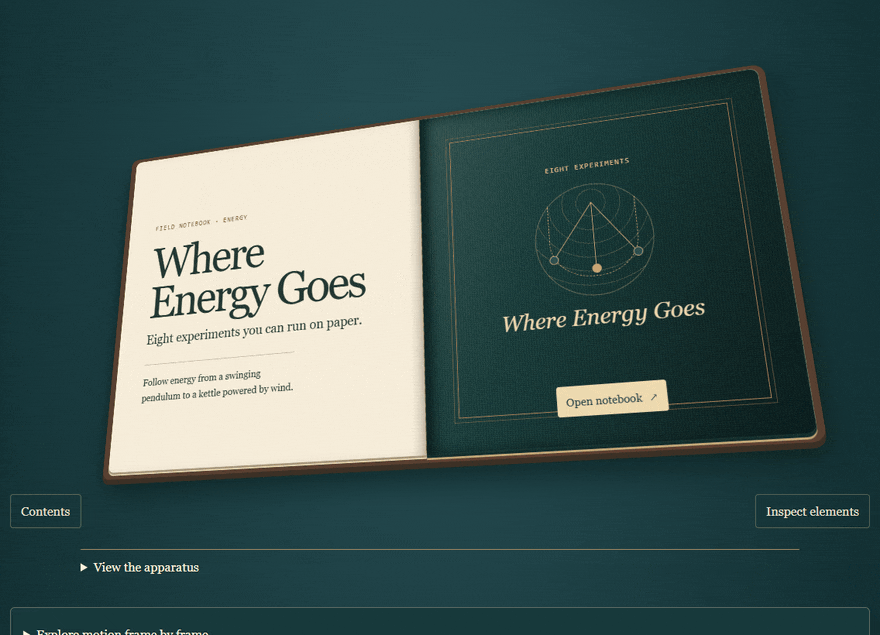

# Inkleaf

**A Three.js toolkit and coding-agent skill for interactive 3D pop-up books.** Build a book that turns real-looking pages, lets readers run experiments, and gives authors frame-by-frame control of camera, page, and lens motion.



*Frames captured from the running notebook.*

## Try the field notebook

```sh
git clone https://github.com/OthmanAdi/inkleaf.git
cd inkleaf
npm ci
npm run dev
```

Open the address printed by Vite. Choose **Open notebook** to see the opening camera. Use **Contents** to jump several lessons and see the page riffle. On **The swing**, raise the apparatus and drag the bob or change its starting angle with the slider.

## What you can build

| Feature | In the demo | Where to change it |
| --- | --- | --- |
| Perspective camera arrival | The closed book approaches and opens into the first spread. | [Book motion](src/demo/book-motion.ts) |
| Staggered page riffle | Contents jumps turn overlapping leaves in either direction. | [Riffle sampler](src/demo/book-motion.ts) |
| Interactive Three.js scenes | Eight physics experiments have controls, readings and a scene you can touch or inspect. | [Lesson models](src/demo/lessons/) and [figure rendering](src/demo/lesson-figures.ts) |
| Procedural materials and lights | Seeded paper grain, drawn ink edges and named key-light controls. | [Paper and lighting](src/demo/plate-finish.ts) |
| Refractive magnifier | The live inset bends and separates color at its edge. Use the pointer, touch or arrows from the Magnifier button. | [Optical sampling](src/motion/refraction.ts) |
| Frame-by-frame animation | Seek the camera, riffle, reveal, experiment, lens sweep, orbit and guided demonstration. | [Frame sampler](src/motion/frames.ts) and [authoring guide](.agents/skills/inkleaf/references/authoring.md) |
| Study tools | Eight quiz questions, searchable glossary, sources, teacher notes, contrast and optional page sound. | [Study desk](src/demo/study/) |

## Use the coding-agent skill

| Use | How |
| --- | --- |
| Design a book in this checkout | Point your coding agent to [`SKILL.md`](.agents/skills/inkleaf/SKILL.md) and name the lesson, interaction and visual direction you want. |
| Reuse a camera or page animation | Give the agent the motion ID, starting and ending poses, desired timing and target project. Keep frame zero and the last frame explicit. |
| Build a different scene | Start from the [lesson contract](src/demo/lesson-contract.ts). Write a deterministic sample and a figure that reads it. The skill explains where to keep materials, lighting and controls. |
| Copy the skill into another agent | Copy [the skill directory](.agents/skills/inkleaf) into that agent's skills folder. Give it the source checkout path so it can inspect and verify real modules. |

Example request

> Use the Inkleaf skill to build a chapter on levers. Let the reader move a weight, show torque in newton-metres, and make the page reveal and experiment seekable at 60 frames per second.

## Verify

| Command | Purpose |
| --- | --- |
| `npm run dev` | Run the reader locally. |
| `npm run check` | Run type checking, unit tests, and a production build. |
| `npx playwright install chromium` | Install the browser for the desktop and mobile-emulation suite. |
| `npm run test:e2e` | Check reader navigation, physics, frame seeking and the study tools in the browser. |
| `npm run preview` | Serve the production build locally. |

Source under [Apache-2.0](LICENSE). Runtime and font attributions are in [Third-party notices](THIRD_PARTY_NOTICES.md).
