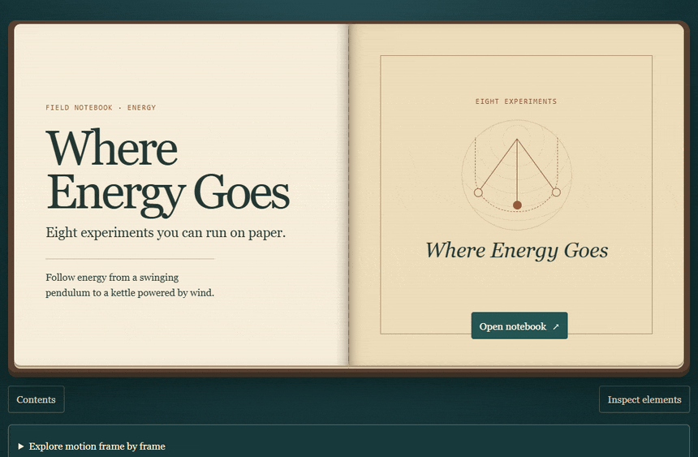

# Inkleaf

Inkleaf is a TypeScript and Three.js toolkit for interactive pop-up books. It separates lesson data, scene rendering, motion and page appearance so each subject can have its own diagram and interaction.



Captured from the running notebook at selected frames.

## Open the notebook

```sh
npm ci
npm run dev
```

Open the Vite address and choose **Open notebook**. Contents lists eight physics experiments. Each lesson has its own settings, scene and readings. Use **Explore motion frame by frame** to seek through the current experiment or another animation. The **Magnifier** button opens a 2× detail view with a term card.

On **The swing**, drag and release the bob or adjust **Starting angle** with the keyboard and choose **Release bob**. Toggle **Air drag** to compare the energy readings.

Use the left and right arrow keys or Shift+wheel to move between pages. On touch screens, swipe across the paper to turn pages. The magnifier help explains its pointer, touch and keyboard controls.

## Create a lesson

Start with the [Inkleaf skill](.agents/skills/inkleaf/SKILL.md), then use the [authoring guide](.agents/skills/inkleaf/references/authoring.md). The swing data is in `src/demo/lesson.ts`; the seven additional lessons are in `src/demo/lessons/`; their figures are in `src/demo/lesson-figures.ts`. Page and experiment motion controls are in `src/demo/motion.ts` and `src/motion/`.

Run `npm run check` for type checking, unit tests and a production build. For browser checks, run `npx playwright install chromium` once and then `npm run test:e2e`. Project code is licensed under [Apache-2.0](LICENSE). Third-party package and font terms are in [THIRD_PARTY_NOTICES.md](THIRD_PARTY_NOTICES.md).
